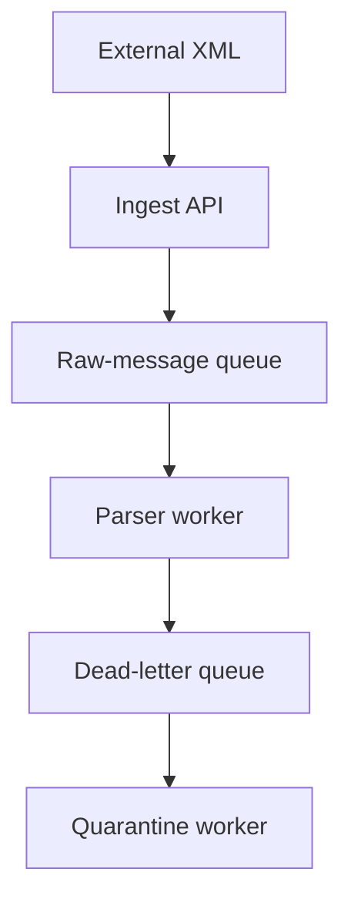

# Start Here — AIDX Pipeline Security Lab

This guide explains exactly what this repository does and how to run it safely on your own computer.

## What is this project?

This is a **local security training lab**. It demonstrates why unsafe XML parsing can be dangerous in an event-processing pipeline and shows the secure alternative.

The project does **not** connect to a remote system, need a target IP, contain credentials, or modify system files. Its test file is created temporarily by the lab and deleted automatically at the end.

## What you will see

The project contains two parsers:

| File | Purpose |
|---|---|
| `lab/vulnerable_parser.py` | Intentionally unsafe: resolves an XML external entity |
| `lab/secure_parser.py` | Hardened: rejects dangerous XML before it is parsed |

The demonstration sends the same XML to both. The vulnerable parser reads a **lab-only marker file**. The secure parser refuses the document.

## Step 1 — Download the code

```bash
git clone https://github.com/YOUR-ACCOUNT/aidx-pipeline-security-lab.git
cd aidx-pipeline-security-lab
```

Replace `YOUR-ACCOUNT` with the GitHub account that owns this repository.

## Step 2 — Install the one required Python library

Create a virtual environment first so the lab does not change your global Python installation:

```bash
python3 -m venv .venv
. .venv/bin/activate
python -m pip install -r requirements.txt
```

On Windows PowerShell, activate it with:

```powershell
.\.venv\Scripts\Activate.ps1
```

## Step 3 — Run the safe XXE demo

```bash
./scripts/run-safe-demo.sh
```

Expected output:

```text
[1/2] Unsafe parser: entity resolution is enabled.
AIDX-LAB-MARKER
[2/2] Hardened parser: dangerous XML is rejected.
rejected: DOCTYPE and ENTITY declarations are not allowed
Demo completed: the hardened parser blocked the unsafe XML feature.
```

## Step 4 — Understand the result

The first parser has this configuration:

```python
etree.XMLParser(load_dtd=True, resolve_entities=True, no_network=False)
```

This means:

- `load_dtd=True`: the parser accepts DTD definitions;
- `resolve_entities=True`: the parser expands entities referenced in XML;
- `no_network=False`: the parser is allowed to make network requests.

For untrusted XML, this is unsafe. It allows XML data to refer to resources outside the document.

The safe parser rejects `DOCTYPE` and `ENTITY` declarations and uses this configuration:

```python
etree.XMLParser(
    load_dtd=False,
    resolve_entities=False,
    no_network=True,
    huge_tree=False,
)
```

## Step 5 — Run the regression tests

```bash
python -m unittest discover -s tests -v
```

Three tests should pass:

1. Normal XML is accepted.
2. XML containing a DTD/entity declaration is rejected.
3. The deliberately unsafe parser still demonstrates the difference using the local marker file.

## Why the queue and service account matter

The core risk is bigger than one XML parser. A real pipeline can have this shape:



A message does **not** become trustworthy merely because it entered a queue. Every worker, including a dead-letter or quarantine worker, must keep treating it as untrusted data.

The impact becomes severe when multiple decisions are combined:

1. XML entity resolution is enabled.
2. Untrusted raw messages flow to downstream workers.
3. A quarantine service runs with administrator privileges.
4. The service invokes an interpreter on a helper file.
5. An application or database account can modify that helper directly or indirectly.
6. Secrets are exposed through command-line arguments or readable process metadata.

## Production remediation checklist

- Disable DTD loading and external entity resolution.
- Reject `DOCTYPE` and `ENTITY` declarations at the ingest boundary.
- Treat queue and dead-letter messages as untrusted forever.
- Run parsers, formatters, and quarantine workers with a dedicated low-privilege account.
- Do not pass secrets through command-line arguments.
- Do not grant database file read/write capabilities to application accounts.
- Keep interpreter-loaded scripts outside database-controlled or application-writable directories.
- Run the regression tests in CI after parser or dependency changes.

## Next reading

- [`docs/architecture.md`](docs/architecture.md): trust boundaries in the pipeline.
- [`docs/security-review.md`](docs/security-review.md): security-review questions.
- [`docs/remediation.md`](docs/remediation.md): implementation and hardening guidance.
